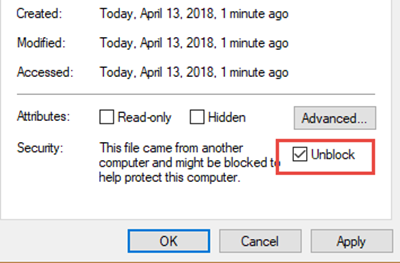

# WoWs Monitor Companion

WoWs Monitor Companion is a small tray app that helps WoWs Monitor read battle replay data when Chrome cannot access the game's system folders through its file API.

The companion watches the replay folder used by your World of Warships client and copies `tempArenaInfo.json` to a folder you choose. WoWs Monitor can then use the copied file without needing browser access to the game's protected folders.

## Getting started

You can place the executable anywhere on your computer; it does not need to be installed in a specific folder.
Download the latest executable from the [Releases page](https://github.com/stewieoO/wows-monitor-companion/releases).

1. Start WoWs Monitor Companion.
2. Choose your World of Warships installation folder.
3. Choose a destination folder. 
   - This can be any folder of your choosing, as long as it is not in one of the blocked paths.
   - Unfortunately the list of blocked paths is not easily readable, so you might have to ensure that the monitor can actually select the destination folder.
4. Select **Save and start monitoring**.
5. In WoWs Monitor, drag and drop in the destination folder you selected.

The companion finds the replay folder from your game configuration. If replay settings change, it updates the folder it watches. An existing `tempArenaInfo.json` file is copied when monitoring starts, and new or changed files are copied as they appear.

Closing the app window leaves it running in the system tray. Use the tray icon to reopen the window or quit the app. Enable **Start this app when I log in** in the app if you want it to start minimized each time you sign in.

## Windows users

Windows may block the downloaded executable because it came from another computer. Before running it, right-click the `.exe`, select **Properties**, check **Unblock** under **Security**, then click **Apply** and **OK**.

## More information

See [How to build](docs/how-to-build.md) for developer build instructions.
